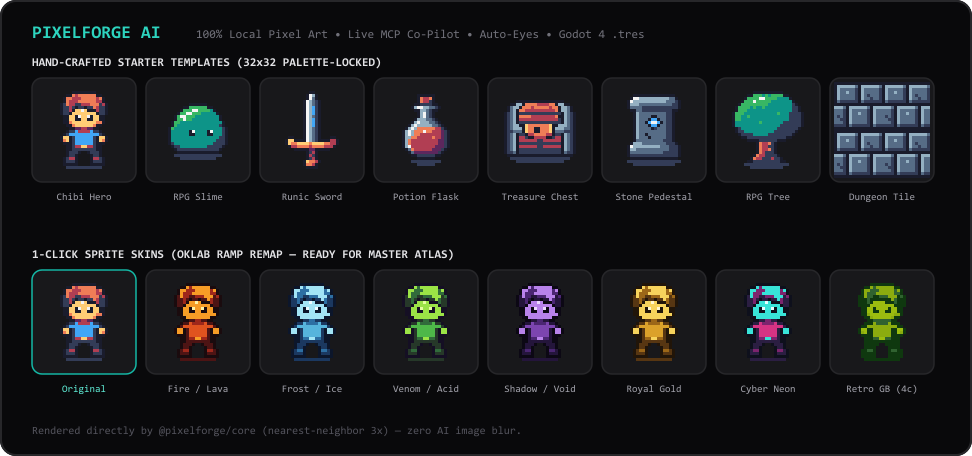

# PixelForge AI

**Pixel art, frame-by-frame animation, and procedural VFX studio with a built-in local MCP server** — so AI assistants in your IDE (**Cursor, Claude Code, Codex, Windsurf, Antigravity**) inspect and edit the exact same live canvas, layers, palette, and undo history you work on by hand.

[](https://github.com/Suturobery/pixelforge-ai/releases/latest)
[](https://discord.gg/2f5MvmAqF)



---

## Download

Get the latest desktop installer for **Windows**, **macOS**, or **Linux** from [GitHub Releases](https://github.com/Suturobery/pixelforge-ai/releases/latest).

Desktop builds include automatic background update checks and in-app update notifications.

---

## Key Features

- **Pixel Art & Animation Studio** — Layers with blend modes & opacity, linked cels, timeline with per-frame timing, onion skinning, symmetry/mirror, dithering, tile wrap, and 2,000+ curated palettes.
- **Live AI Artist Co-Pilot HUD & Auto-Eyes** — Watch connected IDE agents paint onto the canvas in real time with a moving AI brush cursor, progressive pixel reveal, live `+N px` status pill, connected-agent indicator, **Hold-to-Compare (`Before`)** peek, **1-click & per-step Undo**, **Artist Priority Pause**, **Auto-follow + Jump**, and two-way **`artistContext`** (agents see your active marquee selection, colors, symmetry, and wrap mode). Every drawing tool automatically returns a zoomed gridded preview image plus `visualCheck` (cropped ASCII pixel map, bounds, floating fragments, symmetry %, and common-sense warnings) so agents actually *see* and fix crooked details as they draw.
- **Built-In Local MCP Server (1-Click IDE Setup)** — Auto-detects **Cursor, Claude Code, Codex, Windsurf, and Antigravity** and connects with 1 click (safe `.bak` backup, loopback `127.0.0.1` only, revocable per-client tokens, L0/L1/L2 permission tiers).
- **Second Brain & Instant Actions** — Deterministic prompt interpreter & enhancer with 1-click local execution (**Run VFX**, **Drop Starter Base**, **Open Motion**), **Copy for IDE AI** (carries live canvas/selection/palette context), and a **Task Board** with 1-click wake triggers.
- **AI-Proof Consistency Pack** — Starter Sprite Templates (`chibi-humanoid`, `slime`, `rpg-sword`, `treasure-chest`, `dungeon-tile`, etc.), **Hero Sprite Style Anchor** (locks height, ground line, and outline across characters), **Style Lock**, **Auto Craft Gate** (flags orphan pixels, doubles, and jaggies), and **Artwork Review**.
- **Motion Presets & Procedural VFX** — Body-part animation presets (`idle`, `walk`, `run`, `jump`, `attack`, `hit`) and deterministic seeded pixel VFX (`fire`, `lightning`, `explosion`, `portal`, `smoke`, etc.).
- **Aseprite Importer** — Open or drag-and-drop `.ase` / `.aseprite` files with layers, frames, timings, tags → clips, and palettes preserved.
- **Sprite Skins / Palette Variants** — Clone any clip into elemental/RPG skins (`Fire`, `Ice`, `Poison`, `Shadow`, `Royal Gold`, `Cyber`, `Retro GB`, `Stone`) in 1 click or via MCP (`create_skin_variants`).
- **Game Engine Export** — Export PNG frames, sprite sheets, **Master Atlas** (all clips), lossless pixel-art **GIF**, **Aseprite JSON** (Unity / Phaser / PixiJS), and **Godot 4 `SpriteFrames` (`.tres`)**, with pre-export **Asset Set Check**.
- **100% Local & Deterministic** — No cloud lock-in and no paid image-generation APIs required.

---

## Documentation

Full guides live in [`docs/`](docs/README.md):

- [User Guide](docs/user-guide.md) — Tools, shortcuts, layers, timeline, Motion, VFX, export, and settings
- [Connecting AI Agents (MCP)](docs/connect-agents.md) — Pairing Cursor, Claude Code, Codex, Windsurf, and Antigravity
- [AI & MCP Reference](docs/ai-agents.md) — Permission tiers, tool catalog, task board, and Second Brain
- [Architecture](docs/architecture.md) — Desktop shell, CommandBus, editor bridge, and security boundaries
- [Development Guide](docs/development.md) — Running locally, testing, and building installers

---

## Quick Start (Development)

```bash
# Install dependencies
bun install
cd mini-services/mcp-server && bun install && cd ../..
cd apps/desktop && npm ci && cd ../..

# Generate Prisma client & run web studio + MCP server
bunx prisma generate
bun run dev
```

For the Electron desktop shell:

```bash
cd apps/desktop && npm run dev
```

---

## Community & Support

Have a bug report, feature idea, or sprite showcase? Join the **[PixelForge AI Discord](https://discord.gg/2f5MvmAqF)** or use **Help & feedback (?)** inside the app.
